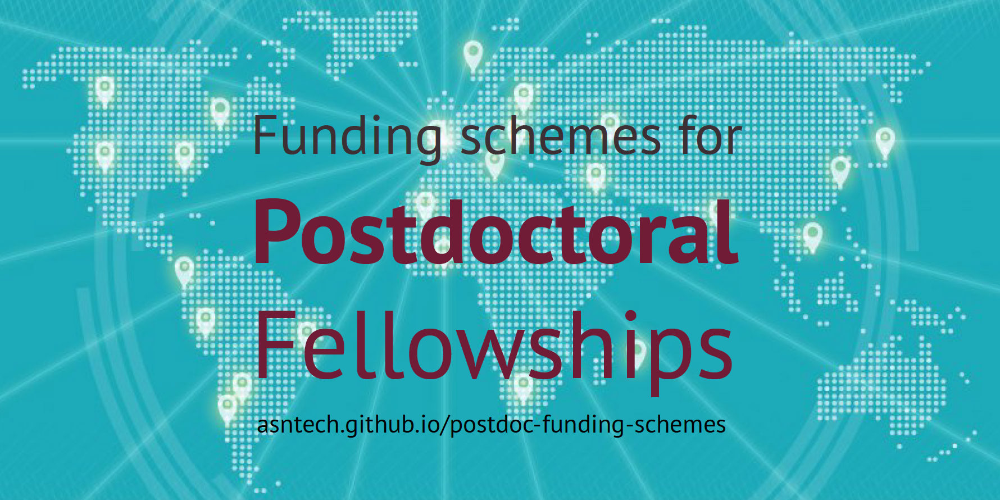
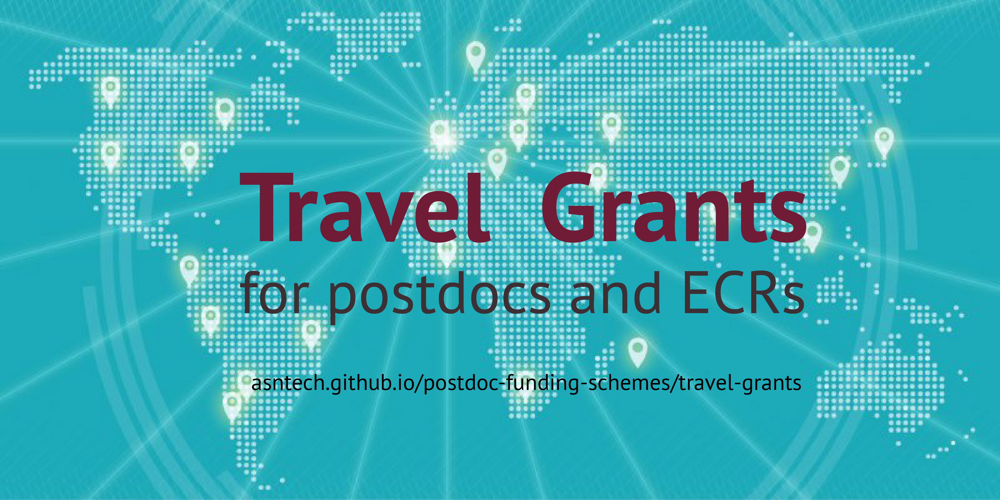

{fig-alt="Funding schemes and fellowship opportunities for postdoctoral researchers."}

In early 2018, I became the [eLife Ambassador](https://elifesciences.org/inside-elife/912b0679/early-career-advisory-group-elife-welcomes-150-ambassadors-of-good-practice-in-science) along with more than 150 others to work to catalyse improvements in the way science is communicated and performed. I have joined the initiatives, with focus on;

> Science communication, publishing, funding, open access, open science, preprints, and reproducibility

In the funding initiative, the eLife Ambassadors created a comprehensive Excel sheet of funding schemes and opportunities for postdocs and early career researchers. I then turned that Excel sheet into a searchable HTML [page](https://asntech.github.io/postdoc-funding-schemes/), which was later taken off on Twitter.

> Very useful for all [#postdocs](https://twitter.com/hashtag/postdocs?src=hash&ref_src=twsrc%5Etfw): List of [#funding](https://twitter.com/hashtag/funding?src=hash&ref_src=twsrc%5Etfw) schemes and opportunities for postdoctoral [#fellowships](https://twitter.com/hashtag/fellowships?src=hash&ref_src=twsrc%5Etfw) <https://t.co/geFXpH6GFn> created by [#eLifeAmbassadors](https://twitter.com/hashtag/eLifeAmbassadors?src=hash&ref_src=twsrc%5Etfw) [\@eLifeCommunity](https://twitter.com/eLifeCommunity?ref_src=twsrc%5Etfw)
>
> --- Lotte de Winde (@lotte_dewinde) [February 1, 2018](https://twitter.com/lotte_dewinde/status/959178973593985025?ref_src=twsrc%5Etfw)

> Here's a list of funding schemes and opportunities for postdoctoral fellowships curated/edited by myself and [\@khanaziz84](https://twitter.com/khanaziz84?ref_src=twsrc%5Etfw) <https://t.co/rq3mgsUDPp> [#eLifeAmbassadors](https://twitter.com/hashtag/eLifeAmbassadors?src=hash&ref_src=twsrc%5Etfw) [\@eLifeCommunity](https://twitter.com/eLifeCommunity?ref_src=twsrc%5Etfw) [\@eLife](https://twitter.com/eLife?ref_src=twsrc%5Etfw)
>
> --- Juan Quintana, PhD. (@Jquintanalcala) [February 1, 2018](https://twitter.com/Jquintanalcala/status/959144479356747777?ref_src=twsrc%5Etfw)

> This is an awesome catalogue of postdoc funding opportunities: \>230 grant schemes worldwide w/ links, duration, eligibility (h/t [\@DieterLukas](https://twitter.com/DieterLukas?ref_src=twsrc%5Etfw) [\@Jquintanalcala](https://twitter.com/Jquintanalcala?ref_src=twsrc%5Etfw) [\@khanaziz84](https://twitter.com/khanaziz84?ref_src=twsrc%5Etfw)) <https://t.co/z2stFr5IHW>
>
> --- Mike Inouye (@minouye271) [February 4, 2018](https://twitter.com/minouye271/status/960056071187410944?ref_src=twsrc%5Etfw)

> Post-doc and PhD friends!\
> Here is a very useful list of 244 different funding opportunities worldwide <https://t.co/wsIXlYEhZE>
>
> --- Hannah Whitby (@CopperChemist) [March 23, 2018](https://twitter.com/CopperChemist/status/977101690888491008?ref_src=twsrc%5Etfw)

{fig-alt="Travel-grant opportunities for postdocs and early-career researchers."} Then the Ambassadors Lotte de Winde et al. created a detailed list of travel funding opportunities for postdocs, which is now available [here](https://asntech.github.io/postdoc-funding-schemes/travel-grants/)

> I made a list with travel funding opportunities for postdocs: <https://t.co/mwTiqMqv8C>\
> List is not complete yet - which ones are missing?[#postdoc](https://twitter.com/hashtag/postdoc?src=hash&ref_src=twsrc%5Etfw) [#funding](https://twitter.com/hashtag/funding?src=hash&ref_src=twsrc%5Etfw) [#eLifeAmbassadors](https://twitter.com/hashtag/eLifeAmbassadors?src=hash&ref_src=twsrc%5Etfw)
>
> --- Lotte de Winde (@lotte_dewinde) [March 5, 2018](https://twitter.com/lotte_dewinde/status/970599315231166464?ref_src=twsrc%5Etfw)

> Here\'s a great list of \>60 travel grant opportunities for postdocs and ECRs <https://t.co/KvTNfhqSSd> curated by [#eLifeAmbassadors](https://twitter.com/hashtag/eLifeAmbassadors?src=hash&ref_src=twsrc%5Etfw) [\@lotte_dewinde](https://twitter.com/lotte_dewinde?ref_src=twsrc%5Etfw) et al. [#funding](https://twitter.com/hashtag/funding?src=hash&ref_src=twsrc%5Etfw)
>
> --- Aziz Khan (@khanaziz84) [March 6, 2018](https://twitter.com/khanaziz84/status/970894803541151744?ref_src=twsrc%5Etfw)

We encourage the community to help to add new funding opportunities to the list by using the submit tab in the links. You can also [fork](https://github.com/asntech/postdoc-funding-schemes) GitHub repo and submit a pull request.

> Now this funding list became ECRcentral [ecrcentral.org](https://ecrcentral.org/)
