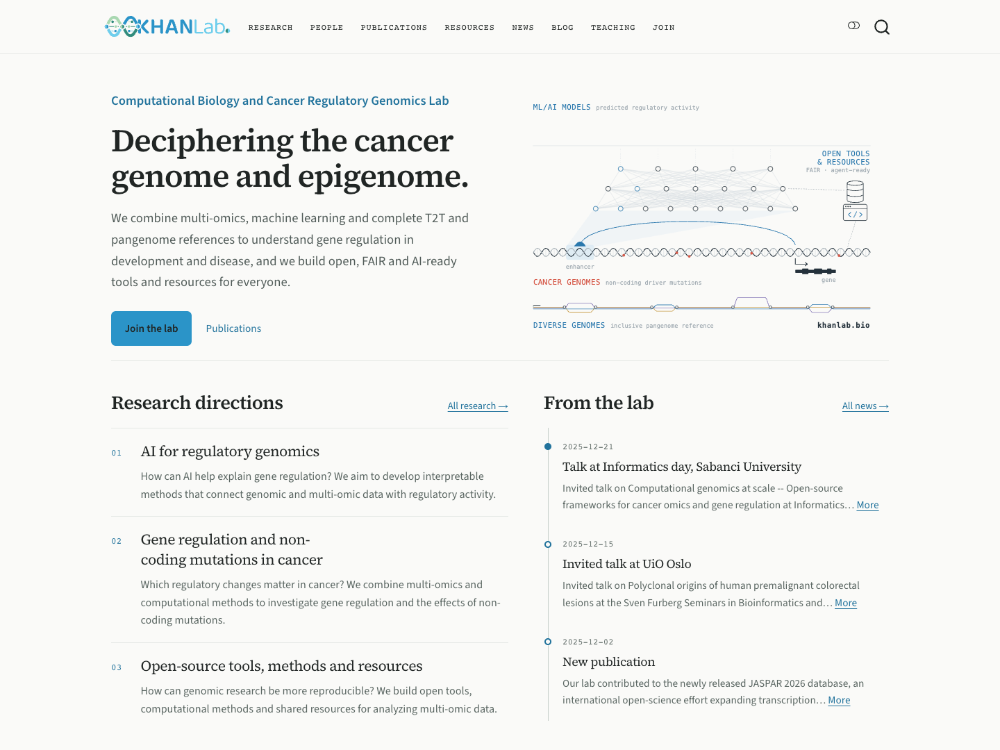

A lab website should make it easy to understand the science, meet the people behind it and find their work. Keeping that information current should fit into a research group's everyday workflow.

We have been developing **ResearchLabFolio**, an open-source website template for academic labs built with Quarto. It brings research directions, people, publications, software and resources, news, blog posts and teaching into one project, with content stored in editable YAML and Markdown files.

The [source code is available on GitHub](https://github.com/khan-lab/researchlabfolio). The CBCRG development example shows how the template can be adapted to a lab's research and visual identity:

{fig-alt="Screenshot of the CBCRG development homepage, showing the lab introduction, regulatory-genomics summary figure and research directions."}

## Content that connects

ResearchLabFolio connects information that otherwise tends to be maintained in separate places. Member profiles can show their associated publications, teaching and authored posts. Research directions can link to related people, papers and resources. Alumni entries preserve former roles and a concise “Now:” line.

Publication pages support search and filters, with DOI, preprint, PDF, code and data links where those destinations are supplied. Publication discovery is a review workflow: retrieved records remain candidates until they are approved for the site's bibliography. Labs can keep curated corrections and decide which papers belong on each member's profile.

Optional Blog and Teaching sections extend the same content model. Posts support categories, tags, multiple authors, citations and sharing links. Teaching entries can represent courses, workshops or guest lectures, with offerings, terms, institutions, instructors and links to materials.

## A shared design with a lab's own identity

Labs can configure colors, fonts, logos, homepage statements and images in `lab.yml`. The layout supports light and dark appearances, responsive pages and optional sections. The CBCRG example uses its research overview figure, compact publication lists and lab-specific content; a separate generic demo provides sample material for new sites.

The rendered website is static. It does not require a database or an always-running application server. Content and configuration can be reviewed through GitHub alongside the changes that update the website.

## Start with a fork or the CLI

You can fork the [ResearchLabFolio repository](https://github.com/khan-lab/researchlabfolio), replace the sample content and preview the result locally:

```sh
pixi install --locked
pixi run preview
```

The included `researchlabfolio` command, also available as `rlf`, provides another route for creating a site and managing content. Its import and export tools support existing website sources and structured records, including CSV/TSV member lists and bibliographic formats. Imported content can be checked and edited before publication; historical posts can retain their original dates and local images.

The [documentation](https://khan-lab.github.io/researchlabfolio/) covers the fork and CLI workflows, content editing, migration, branding, validation and GitHub Pages publishing. Creating or previewing a site does not deploy it.

## Explore and contribute

ResearchLabFolio is available under the BSD 3-Clause license. We welcome practical feedback from research groups about what makes a lab website easier to maintain and more useful to its readers.

- [Browse the source code](https://github.com/khan-lab/researchlabfolio)
- [Read the documentation](https://khan-lab.github.io/researchlabfolio/)
- [Report an issue or suggest an improvement](https://github.com/khan-lab/researchlabfolio/issues)
