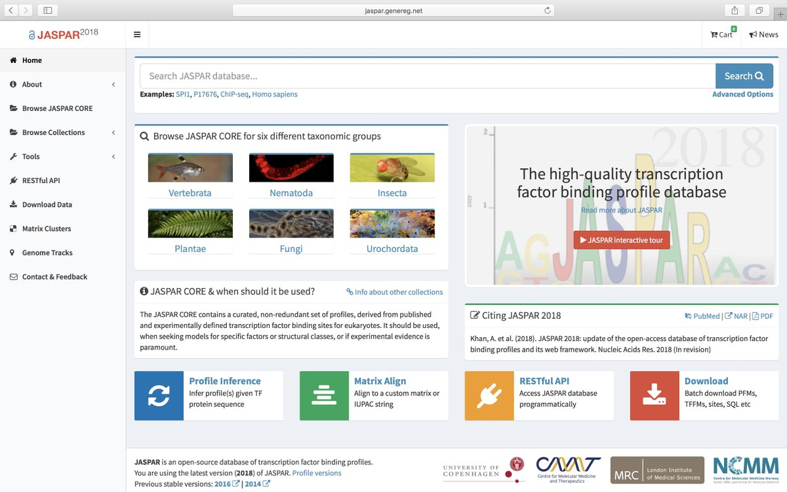
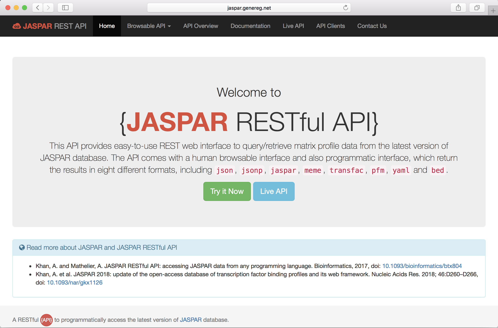

[JASPAR](http://jaspar.genereg.net/) is an open-access database of transcription factor binding profiles across multiple species in six taxonomic groups. It was first developed by [Albin Sandelin](http://albinsandelin.wixsite.com/sandelinlab) during his Ph.D. at Karolinska Institutet, Sweden in 2004. JASPAR is an extremely useful resource for transcriptional gene regulation community, and it has been widely used and cited (\>4,000 citations).

Since then JASPAR database has been extensively updated almost every second year. For the seventh release of JASPAR, I got involved to redevelop the entire database including its features and user interface. Previously, JASPAR was developed by Albin mainly in Perl. I have written all the code in Python and developed it using the MVC web-framework Django. Below is the screenshot of the new interface and you can browse it here <http://jaspar.genereg.net/>

{fig-alt="Screenshot of the redesigned JASPAR 2018 database homepage."}

I met Albin first time in August 2017 at the FANTOM6 annual meeting in Yokohama. He was very excited about the new look of JASPAR. He told me how he curated the data for JASPAR at the beginning. Back then most of the scientific content was not online, so he used to sit in the library for hours and find papers which report the TF binding sites data. He used to write all the sequences one by one, but later he got an OCR machine to scan the papers to get the letters A, C, G, and T.

For the first release of JASPAR, he collected 111 profiles, which was greatly expended over the releases in 2006, 2008, 2010, 2014 and 2016. In the seventh 2018 release of JASPAR, we have intotal 1404 non-redundant profiles in the CORE collection.

Apart from profile expansion, the new website comes with new features:

-   Enhanced browsing and searching
-   A shopping cart without checkout
-   A REST interface
-   Semantic URLs
-   URL redirection
-   Responsive (mobile-friendly)
-   Profiles can be downloaded in eight widely used formats

The seventh release appeared in the 2018 database issue of the *Nucleic Acids Research* journal.

> Khan, A. et al. JASPAR 2018: update of the open-access database of transcription factor binding profiles and its web framework. Nucleic Acids Res. 2018; 46:D260--D266, doi: [10.1093/nar/gkx1126](https://doi.org/10.1093/nar/gkx1126)

We also introduced, first time, a [RESTful API](http://jaspar.genereg.net/api/) to retrieved the JASPAR data programmatically.

{fig-alt="Screenshot of the JASPAR REST API interface."}

The RESTful API was published as an application note in the journal *Bioinformatics*

> Khan, A. and Mathelier, A. JASPAR RESTful API: accessing JASPAR data from any programming language. Bioinformatics, 2017, doi: [10.1093/bioinformatics/btx804](https://doi.org/10.1093/bioinformatics/btx804)

The source code for the website and RESTful API is freely available [here](https://bitbucket.org/CBGR/jaspar) under GPL v3 license.

I'm very excited to be part of JASPAR consortium and contribute to this great resource.

P.S. If you're curious about what JASPAR stands for, check [FAQs](http://jaspar.genereg.net/faq/#who-is-jaspar-anyhow) ;-)
