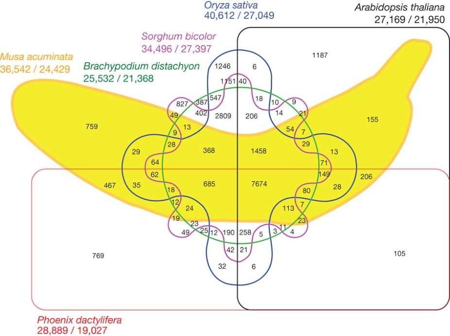
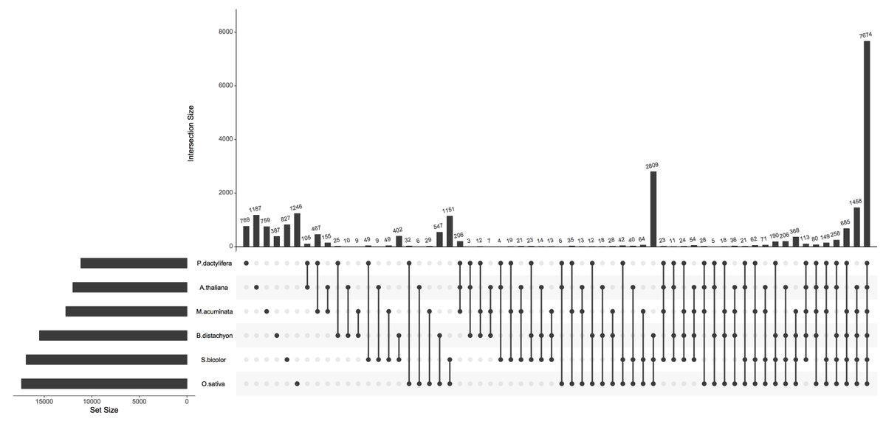
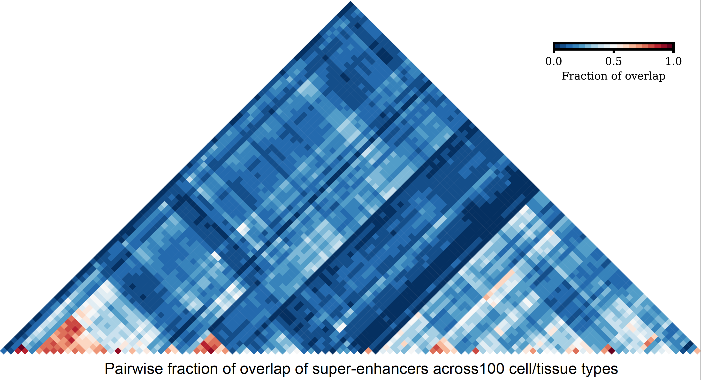
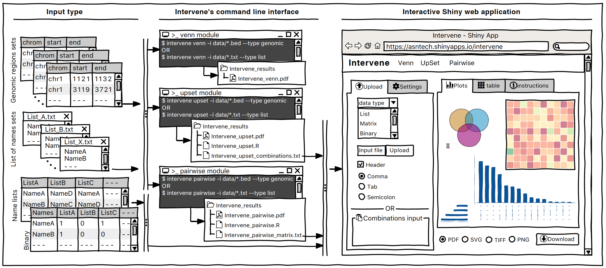

For decades [Venn diagrams](https://en.wikipedia.org/wiki/Venn_diagram) (created by [John Venn](https://en.wikipedia.org/wiki/John_Venn) in 1880) have been a primary way to show set intersections. Although Venn diagrams are very useful in set theory but not scalable if the number of sets increases more than four, it is very difficult to understand them. Also, it's not possible to show more than 6 sets in a Venn diagram. For example, the below six-way Venn diagram shows the distribution of shared gene families among six genomes, taken from [D'Hont et al. (2012) Nature](https://www.nature.com/articles/nature11241), is very complicated to understand.

{fig-alt="Six-way Venn diagram of shared gene families among six plant genomes, from D’Hont and colleagues (2012)."}

An alternative approach, named [UpSet](http://caleydo.org/tools/upset/), was introduced by [Nils Gehlenborg's](http://gehlenborglab.org/) lab at Harvard Medical School to depict the intersection of more than three sets. The advantage of UpSet plots is their capacity to rank the intersections and alternatively hide combinations without intersection, which is not possible using a Venn diagram. There is also an awesome R package [UpSetR](https://cran.r-project.org/package=UpSetR). Below, the above Venn diagram was turned into UpSet, and it looks cool and easy to find where are highest intersections. To know more about UpSet plots, it's recommended to read Nils [slides](https://www.slideshare.net/ngehlenborg/relaxation-techniques-for-the-upset-data-scientist).

{fig-alt="UpSet plot presenting intersections of the six plant-genome gene-family sets."}

However, with a large number of sets, UpSet plots also become an ineffective way of illustrating set intersections. To visualize a large number of sets, one can represent pairwise intersections using a clustered heatmap.

To have these three options in one tool, we developed 'Intervene', for effective intersection and visualization of genomic regions or name list sets and to generate publication-quality figures. Intervene has 3 modules:

-   **upset** to generate UpSet plots of multiple sets,
-   **pairwise** to compute and visualize intersections of multiple sets as clustered heat maps, and
-   **venn** to generate Venn diagrams of up to six sets (for folks who still love Venn diagrams)

{fig-alt="Intervene pairwise intersection heatmap comparing super-enhancer sets."}

Intervene comes with a Python-based command line interface, which can easily be installed through *bioconda*

    conda install -c bioconda intervene

Or through PyPi

    pip install intervene

The source code is freely available on GitHub and Bitbucket

> GitHub: <https://github.com/asntech/intervene>
>
> Bitbucket: <https://bitbucket.org/CBGR/intervene>

I also developed an interactive Shiny web application which is available at:

> <https://asntech.shinyapps.io/intervene>

For more details, you can read our manuscript which appeared in the journal *BMC Bioinformatics*

> Khan A., and Mathelier A. (2017) Intervene: a tool for intersection and visualization of multiple gene or genomic region sets, BMC Bioinformatics. 18(1):287. doi:[10.1186/s12859-017-1708-7](https://doi.org/10.1186/s12859-017-1708-7)

{fig-alt="Diagram of the Intervene Venn, UpSet and pairwise intersection analysis modules."}
