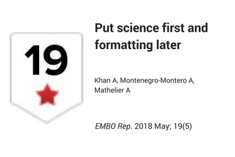

Most academic journals have stringent manuscript formatting guidelines that authors must follow before making an initial submission. This process is extremely time consuming and, in many cases, has to be repeated multiple times for submission to a new journal after rejection.

> Formatting has no impact on the scientific basis of a manuscript, and style plays no role in the ability to judge its scientific content.

It is, therefore, essential to stop these unnecessary and wasteful cycles of formatting to save time and resources.

Isabelle M Côté a professor of Marine Ecology at Simon Fraser University took it to Twitter and asked journals to impose format requirements once a paper is accepted.

> Wouldn\'t it be great if publishers required journal-specific formatting only after MS acceptance? So much time is wasted reformatting papers [pic.twitter.com/wCtNq75obg](https://t.co/wCtNq75obg)
>
> --- Isabelle M Côté (@redlipblenny) [October 4, 2017](https://twitter.com/redlipblenny/status/915382785266802688?ref_src=twsrc%5Etfw)

The good news is some journals already start accepting format-free initial submissions, such as Bioinformatics.

> Good to know that the Bioinformatics journal no longer require to format first submissions according to their guidelines.\
> \
> Science first, format later!\
> \
> I hope other journals will allow too. [#FormatFreeSubmissions](https://twitter.com/hashtag/FormatFreeSubmissions?src=hash&ref_src=twsrc%5Etfw) [pic.twitter.com/MYxFRVdKnG](https://t.co/MYxFRVdKnG)
>
> --- Aziz Khan (@khanaziz84) [November 16, 2017](https://twitter.com/khanaziz84/status/931310161591001088?ref_src=twsrc%5Etfw)

We propose a universal 'format-free' initial submission policy, which has the following characteristics:

-   **Structure-free abstract**
-   **Order-free sections**
-   **Style-free references**
-   **Format-free figures and tables**
-   **Format-free manuscript file**

For more details, read our policy piece on format-free, which just appeared in the journal *EMBO reports* as an opinion article.

> Khan A., Montenegro-Montero A., and Mathelier A. (2018) Put science first and formatting later, doi:[10.15252/embr.201845731](https://doi.org/10.15252/embr.201845731)

We also created a [list](https://asntech.github.io/format-free-journals/) of format-free, YPYW (Your Paper Your Way) and B2J (bioRxiv to journal) journals.

The community greatly appreciated this initiative and our opinion piece in EMBO reports got good attention on Twitter. Here is tweet in Japanese language by Haruka Ozaki a Computational biologist at RIKEN, Japan.

> 「科学が先、形式は後」Put science first and formatting later \| EMBO Reports <https://t.co/rGpdUdMKeG>\
> 再投稿の度に再フォーマットするのは時間の無駄なので「自由なフォーマットでの投稿・査読」を多くの雑誌で可能にしようという提案。生命科学系300誌のリジェクト率のグラフは説得力がある。 [pic.twitter.com/uFfGMiGe71](https://t.co/uFfGMiGe71)
>
> --- Haruka Ozaki (@yuifu) [April 20, 2018](https://twitter.com/yuifu/status/987294091837763585?ref_src=twsrc%5Etfw)

> We urge journals and the scientific community to adopt format-free initial submission policies, to put science first and formatting after.

Our opinion article also received eight recommendations on [F1000Prime](https://f1000.com/prime/733031605?key=QuhHHVzZ1WVOhqq)

Olivier Perts and Jakobus Van Unen from University of Bern, Switzerland wrote this:

> In this opinion article, Khan and colleagues make the long overdue case for format-free first submissions of manuscripts to peer-reviewed scientific journals. Their estimated number of taxpayer-financed hours wasted by scientists on reformatting rejected manuscripts is daunting and, unfortunately, most likely realistic.

It is highly [ranked](https://f1000.com/prime/rankings) in the current top 10 and hidden jewels category on F1000Prime. {fig-alt="F1000Prime image highlighting the article Put science first and formatting later."}
